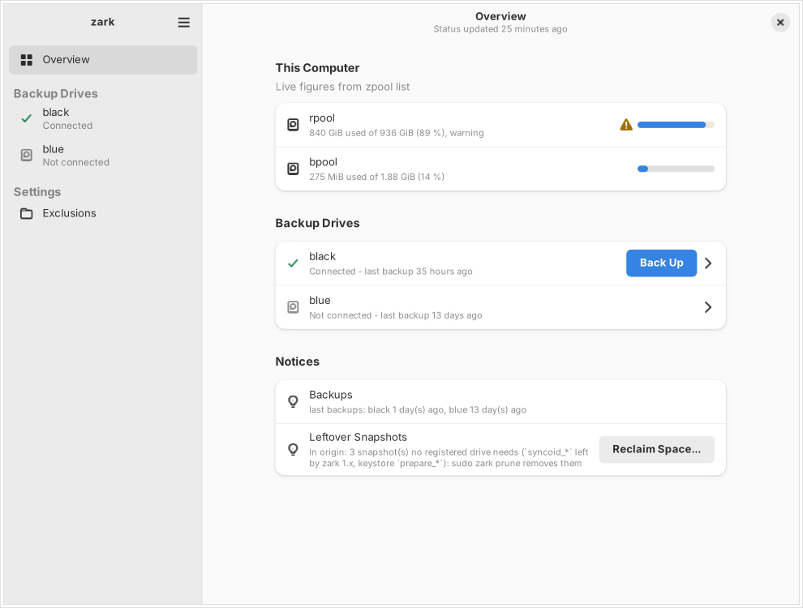
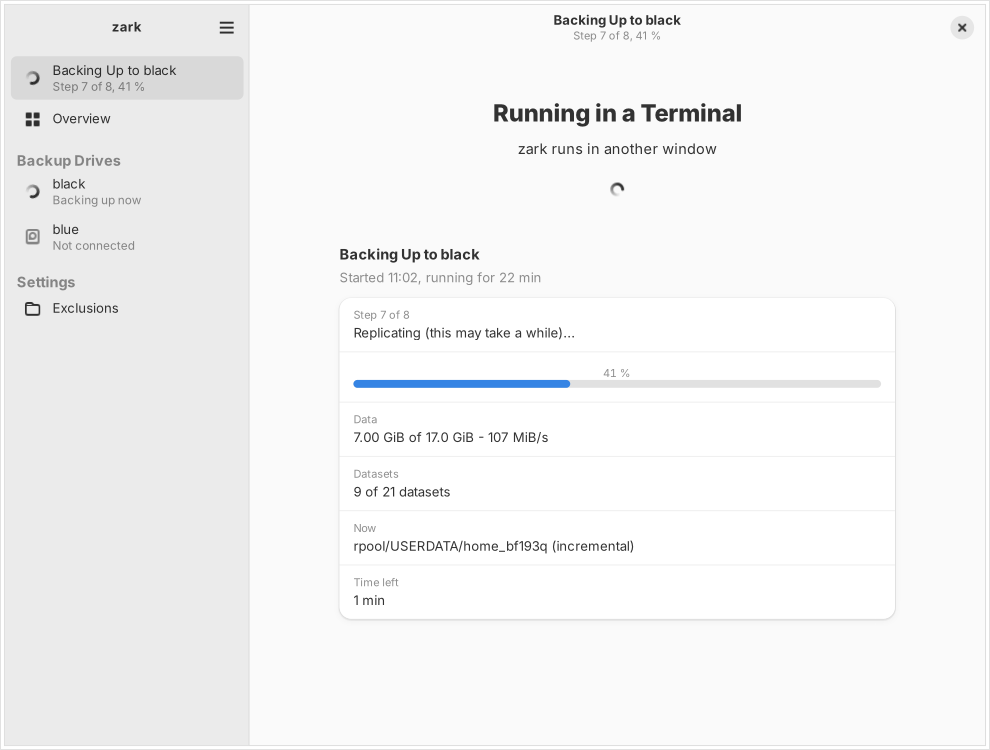
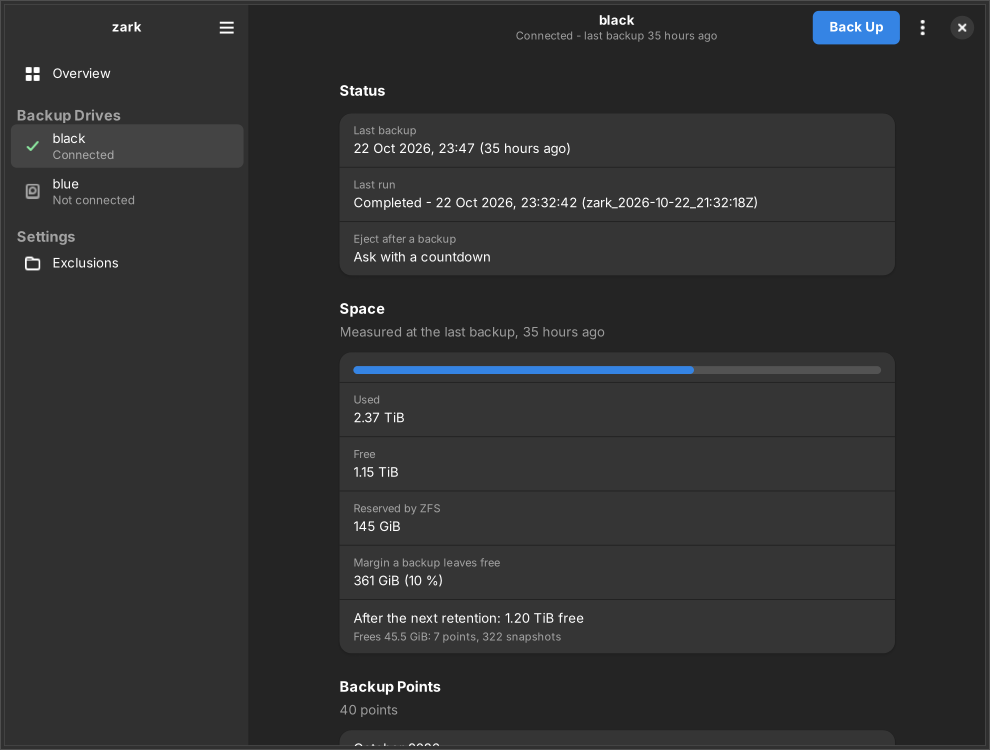

# zark for GNOME

[](https://github.com/juanmitaboada/zark-gnome-app/actions/workflows/ci.yml) [](LICENSE) [](https://sonarcloud.io/summary/new_code?id=juanmitaboada_zark-gnome-app) [](https://sonarcloud.io/summary/overall?id=juanmitaboada_zark-gnome-app) [](https://sonarcloud.io/summary/overall?id=juanmitaboada_zark-gnome-app)

A GNOME app for [zark](https://github.com/juanmitaboada/zark): the state of
your backups and backup drives in one window.

zark backs up an Ubuntu system installed on encrypted ZFS to an external
drive, and rebuilds it, bootable, from a live USB when the disk dies. It
runs in a terminal; this app shows how your backups stand: how full the
system pools are, each backup drive with its last backup, its space and its
backup points by month, the datasets left out of backups, and a backup
running in a terminal, with its progress.

<p align="center">
  
</p>
<p align="center">
  
</p>
<p align="center">
  
</p>

The pictures are rendered from the test fixtures (`make screenshots`), not
from a real machine.

The app reads the two status files the installed
zark writes (`/run/zark/progress.json` and `/var/lib/zark/status.json`,
described in zark's
[`docs/STATUS-FILES.md`](https://github.com/juanmitaboada/zark/blob/main/docs/STATUS-FILES.md))
through zark's own reader, and the live figures of `zpool list`, `zfs list`
and `zfs get`, all without privileges. It never writes zark's files, never
takes its lock and never imports a pool itself.

Each operation (back up, reclaim space, prepare, check, erase or register a
drive, exclusions, retention) runs one zark command,
`pkexec /usr/share/zark/zark <command> ...`, under its own polkit action
(`com.juanmitaboada.Zark.<command>`), with the administrator's password:
kept five minutes per command, asked every time for prepare, purge and
health. zark runs in a terminal inside the window and asks its questions
there as it always does. On Ubuntu 24.04 the terminal is not read by screen
readers (VTE 0.76 has no GTK 4 accessibility); the app's own announcements
still are.

While the app's own command runs, logout and suspend are held: a Suspend
chosen from GNOME's menu asks for the administrator's password first, and
a logout lists zark as the reason. Closing a laptop's lid still suspends
(logind's default, `LidSwitchIgnoreInhibited=yes`).

When a backup's drive goes away during the run (zark 2.3.1 or later), the
app shows one dialog with the drive, the time it went and zark's own advice,
once per run and drive, besides zark's notification. It stays quiet when
zark's GNOME Shell extension 1.3 or later is active, which shows its own;
it asks GNOME Shell (`org.gnome.Shell.Extensions`), and without an answer it
shows the dialog.

What changed in each version is in [CHANGELOG.md](CHANGELOG.md).

## Requirements

- Ubuntu 24.04 LTS, 26.04 LTS or 26.10, with GNOME.
- zark 2.3.0 or later, installed as a package (the app imports its reader
  from `/usr/share/zark`).

## Install

From the PPA zark uses:

```bash
sudo add-apt-repository ppa:juanmitaboada/zark
sudo apt update
sudo apt install zark-gnome-app   # brings zark along
```

## Translations

The app's texts, its desktop entry, its AppStream metadata and its polkit
messages share one gettext domain, `zark-gnome-app`: `make pot` writes the
template `po/zark-gnome-app.pot`, each language is `po/<lang>.po` listed in
`po/LINGUAS`, and the package installs the catalogues under
`/usr/share/locale`. Commands, options and zark's own output stay English
in every language, and so do a few lines whose translation could mislead
about what a command erases. If you are a native speaker and a translation
reads wrong, please open an issue or a pull request on the `.po` file.

## Development

```bash
sudo apt install python3-gi gir1.2-gtk-4.0 gir1.2-adw-1 gir1.2-vte-3.91 \
    xvfb xauth librsvg2-common python3-pytest gettext desktop-file-utils appstream
git clone --branch v2.3.2 https://github.com/juanmitaboada/zark ../zark   # the tag CI uses (ZARK_REF)
make test               # the suite under Xvfb, from the fixtures
make screenshots        # one PNG per state, in build/screenshots
make venv lint          # ruff, mypy, pylint at the pinned versions
make pot                # the translation template, after a text changes
make po-risk            # its msgids that match po/RISK-WORDS, with their review
make run CASE=app:connected
make deb                # the .deb on this machine's series
sudo make deb-all       # the .deb in a clean chroot of each series
```

The tests read zark's status file fixtures (`tests/fixtures/zark-2.3.2/`,
copied unchanged from zark's tag with a sha256 manifest) and the app's own
(`tests/fixtures/app/`); no test runs `zfs`, `zpool`, pkexec or a command of
zark's: `tests/fake_pkexec.py` stands in for pkexec in the terminal tests.

## License

Apache-2.0, as zark. See [LICENSE](LICENSE) and [NOTICE](NOTICE).
